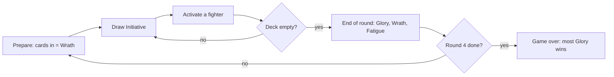

# Round Structure

The game lasts 4 rounds. Turn order each round comes from a shuffled Initiative deck, built from every player's [[Wrath]], so nobody knows who acts next.

1. **Prepare.** Each player may keep 1 Action card from last round, then draws up to a hand of 5. Each player puts Initiative cards into the deck equal to their current Wrath (minimum 2, maximum 8). Shuffle.
2. **Fight.** Turn over the top Initiative card. Its owner activates one fighter: play an [[Action Cards|Action card]] and resolve one of its options, or take a Basic Action (move 1 hex, or Guard) without a card. Repeat until the deck is empty.
3. **End.** Score Glory, adjust Wrath, each fighter removes 1 [[Fatigue]], Guard tokens are cleared.

Activations belong to the player, not the fighter. A player with Wrath 4 gets 4 activations whether they field 3 fighters or 4. A small elite warband spends its activations on fewer fighters and piles up Fatigue faster. A wide warband spreads them out. That is the main warband-building trade-off.

> [!question] Open
> Should activations stay fixed per player (Wrath only), or scale with warband size?

Basic Actions exist so an empty hand never means a dead turn.
