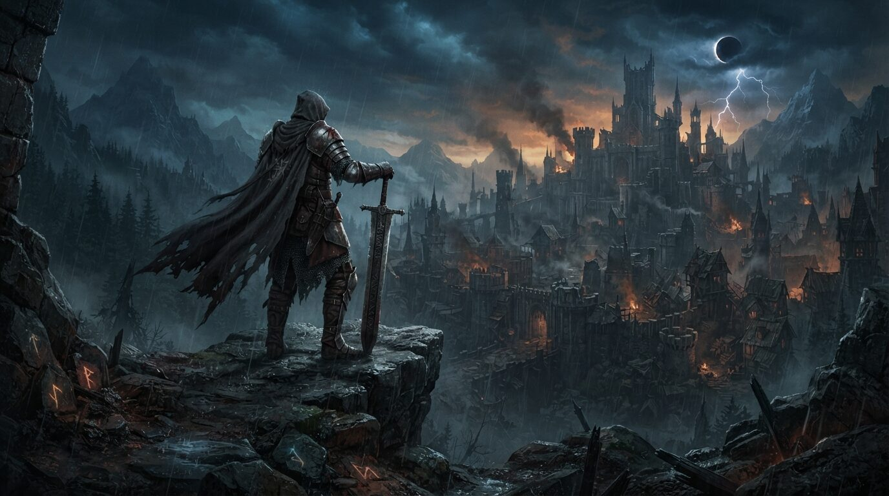

Welcome to the home of **Iron & Marrow**, a tabletop roleplaying game of high fantasy realism, grimdark stakes and small motes of hope, and its companion skirmish game, the **Arena Combat Game**.

Everything here is a living rulebook. Rules change as playtesting continues, so check back often.

## Iron & Marrow — Core Rules

The complete roleplaying system: characters, combat, magic, downtime and more.

→ [Browse the Core Rules](rules/)

## Arena Combat Game

A standalone tactical battle game set in the same world. Build a warband, deploy into the arena and fight for glory.

→ [Browse the Arena Rules](arena/)

## The World of Austhal

The continent, its peoples, its powers and its people of note.

→ [Explore the World](world/)

---

*Use the search bar or the Explorer on the left to jump straight to any rule, place or character.*
